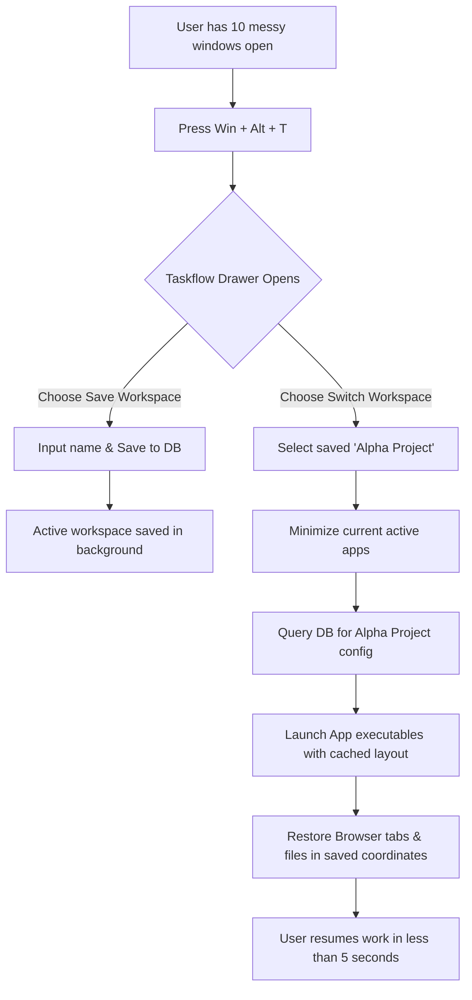
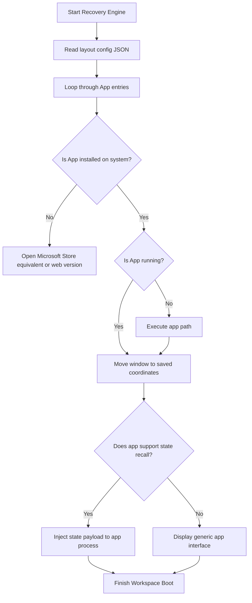

# Windows 11 Product Teardown: Strategic & UX Analysis
**Author**: Senior Product Manager (Ex-Microsoft, Google, Amazon, Apple, Meta)
**Target**: Microsoft Product Leadership & Academic Review Board

---

## Phase 1: Executive Summary

### What Windows 11 Is
Microsoft Windows 11 is the current major release of the Windows NT operating system, serving as the foundational platform for global personal computing, enterprise operations, gaming, and cloud-hybrid workflows. It introduces a modernized interface design (Fluent Design System) and deeply integrates artificial intelligence (Microsoft Copilot) at the shell level, positioning the OS as an orchestrator of local and cloud-based intelligence.

### Mission
To empower every person and every organization on the planet to achieve more by providing a secure, productive, and accessible canvas for computing.

### Vision
Windows 11 is the central node of a user's digital life, seamlessly bridging the gap between local hardware capability (including NPUs), cloud resources (Windows 365), and generative AI, while acting as an open ecosystem for developers and creators.

### Target Users
Windows 11 targets a highly diverse global user base of over 1.4 billion active Windows users, segmented into:
1. **Information Workers / Professionals**: Focused on multitasking, document creation, security, and collaborative tools (Teams, Outlook).
2. **Developers & Creators**: Requiring robust environment setups, WSL (Windows Subsystem for Linux), performance, and multi-monitor management.
3. **Gamers**: Demanding maximum hardware performance, low latency, DirectStorage, and integration with Xbox services.
4. **Students & Casual Users**: Seeking ease of use, long battery life, search accessibility, and educational software.
5. **Accessibility & Assistive Tech Users**: Requiring voice access, live captions, high-contrast themes, and screen reader compatibility.

### Business Model
Windows 11 utilizes a multi-pronged monetization engine:
* **OEM Licensing (Core Engine)**: Licensing fees charged to device manufacturers (Lenovo, HP, Dell, etc.) per pre-installed copy of Windows.
* **Enterprise & Commercial Agreements**: Volume licensing models, including Windows Enterprise E3/E5 subscription tiers, active software assurance contracts, and Windows 365 Cloud PC seats.
* **First-Party Services Upsell**: Driving users into the Microsoft 365 ecosystem (OneDrive storage, Office apps subscription, Xbox Game Pass).
* **Microsoft Store & Developer Platform**: Core app store cuts (typically 12% for games, 0-15% for apps, though customizable models exist for third-party commerce engines).
* **Search and AI Advertising**: Revenue from MSN Widgets feed, Bing integration in the Windows Search box, and Copilot Pro upsells.

```
+-------------------------------------------------------------------------+
|                              WINDOWS 11 OS                              |
+-------------------+--------------------+-------------------+------------+
        |                    |                    |               |
        v                    v                    v               v
 [OEM Licensing]     [Enterprise Sub.]    [M365/Game Pass]   [Ad & Store]
```

### Product Positioning
Windows 11 is positioned as the **premium, secure, and AI-first workspace for modern work and play**. It steps away from the utilitarian aesthetic of Windows 10, positioning itself as a direct competitor to macOS's design polish and ChromeOS's simplicity, while retaining Windows' absolute dominance in gaming and enterprise legacy application compatibility.

### Unique Selling Proposition (USP)
*The only operating system that combines institutional enterprise security, absolute hardware choice, complete legacy software compatibility, and state-of-the-art gaming performance with a built-in local and cloud generative AI assistant.*

### Value Proposition
* **For End Users**: A polished, intuitive interface that organizes clutter (Snap Layouts), protects data out-of-the-box (TPM 2.0 mandated security), and accelerates work with AI assistance.
* **For Enterprise IT**: The most manageable and secure client OS at scale, reducing deployment costs through Windows Autopilot and ensuring compliance with zero-trust architectures.
* **For Developers**: A unified workspace where Windows, Linux (WSL), and Android (WSA - note: now deprecated but replaced by cloud alternatives) environments coexist seamlessly.

### Key Takeaways
1. **The TPM 2.0 Hard Gate**: While the strict security hardware requirements elevated the baseline security of the ecosystem, they created a massive adoption ceiling, stranding hundreds of millions of users on Windows 10.
2. **AI Integration vs. User Friction**: Shell-level features like Copilot and Widgets face pushback because they prioritize Microsoft's strategic business goals (search ad impressions, Bing market share) over user delight (clean layout, fast performance).
3. **The Design Inconsistency Gap**: Despite the visual overhaul, the dual-UI problem persists. Underneath the modern glassmorphism shell lie deep remnants of Windows 8, 7, and even XP configurations (Control Panel vs. Settings app).

---

## Phase 2: Product Research

### History and Evolution
Windows 11 was officially announced in June 2021 and released to the public in October 2021. It succeeded Windows 10, which Microsoft had previously declared in 2015 would be "the last version of Windows." The pivot to Windows 11 was driven by three primary catalysts:
* **The Pandemic PC Boom**: The rapid acceleration of remote and hybrid work required a focus on security, collaboration tools, and video conferencing interface design.
* **Silicon Architecture Shift**: The rise of Intel's hybrid architecture (Performance vs. Efficient cores) and ARM-based computing necessitated an updated kernel scheduler (Thread Director integration).
* **Apple Silicon Threat**: Apple's M-series chips dramatically shifted expectations for performance-per-watt and design coherence, forcing Microsoft to modernize its design language (Sun Valley).

```
Windows 7/8 (Utility/Hybrid) -> Windows 10 (SaaS/Unified OS) -> Windows 11 (Fluent Design/AI-PC)
```

### Current Market Position
As of mid-2026, Windows 11 commands approximately **33%** of the global desktop operating system market share, with Windows 10 still retaining over **60%**. This represents a historically slow upgrade cycle, primarily driven by:
* Strict hardware compatibility requirements (TPM 2.0, Secure Boot, Intel 8th Gen / AMD Ryzen 2000+ CPU limits).
* Enterprise conservatism and resistance to UI changes (such as the centered Start Menu).
* The impending Windows 10 End-of-Life (EOL) in October 2025/2026 driving a rapid commercial hardware refresh cycle.

### Target Audience & Segments
* **The Information Worker (60% of volume)**: Spends 8+ hours a day in productivity suites, requires reliable multi-tasking and quick document recovery.
* **The Gamer (20% of volume)**: Demands frame-rate consistency, HDR accuracy, and immediate disk-to-GPU streaming.
* **The Developer / SysAdmin (10% of volume)**: Requires command-line efficiency, virtualization hooks, and customizable terminal setups.
* **The Casual / Education User (10% of volume)**: Wants frictionless web browsing, basic media consumption, and zero maintenance overhead.

### Revenue & Licensing Model
Windows 11 operates on an indirect monetization model to support Microsoft's high-margin cloud divisions:

| Segment | License Type | Pricing Structure | Key Customer JTBD |
| :--- | :--- | :--- | :--- |
| **Retail Consumer** | Retail License | Included in device purchase price. Standalone Home: ~$139, Pro: ~$199. | "I want my new laptop to work out of the box with my existing software." |
| **OEM Partner** | OEM Volume License | Tiered pricing (~$15-$80 per device) depending on hardware specs and volume. | "I want to ship competitive hardware with the industry-standard OS." |
| **Enterprise Corp** | Volume Licensing / E3 & E5 | Per-user, per-month subscription model (e.g., $7-$15/user/month). | "I need to secure 50,000 devices and control updates centrally." |
| **Cloud PC** | Windows 365 / Azure Virtual Desktop | Flat rate per VM per month, scaled by CPU/RAM/Storage configuration. | "I want my contractors to access a secure corporate desktop from any device." |

### Competitive Landscape
1. **macOS (Apple)**: The gold standard for UI consistency, hardware-software integration, and battery efficiency. Windows 11 competes by offering absolute hardware flexibility, a vastly superior gaming catalog, and lower entry pricing.
2. **ChromeOS (Google)**: Dominates K-12 education due to near-zero maintenance and cheap hardware. Windows 11 competes via offline capability, heavy application execution, and deep local developer tools.
3. **Ubuntu / Desktop Linux**: The choice for pure developers and privacy enthusiasts. Windows 11 counters by integrating WSL, making Linux tools native to Windows without the desktop environment fragmentation of Linux.

### Key Differentiators: Why Users Choose Windows 11
* **The Ultimate Gaming Sandbox**: Unmatched DirectX 12 Ultimate support, driver access, and Game Pass integration.
* **Snap Layouts and Groupings**: The absolute best window management tool across any desktop OS.
* **Backward Compatibility**: The ability to run standard Win32 executables designed 25 years ago alongside modern WinRT and web apps.
* **WSL 2 Integration**: Enables running unmodified ELF64 Linux binaries, docker containers, and bash scripts natively with GPU acceleration.

---

## Phase 3: Market Analysis

### TAM, SAM, SOM Model
* **Total Addressable Market (TAM)**: All global active computing endpoints (PC, Mac, mobile, tablet, cloud) representing **~4.5 Billion devices**.
* **Serviceable Addressable Market (SAM)**: The global personal computer (Desktop, Laptop, Workstation) install base, representing **~1.6 Billion active systems**.
* **Serviceable Obtainable Market (SOM)**: The active Windows ecosystem (~1.4 Billion devices), specifically targetable hardware refreshing to Windows 11 specs by 2026/2027 (**~850 Million devices**).

```
+-------------------------------------------------------------+
| TAM: Global Active Endpoints (~4.5B)                        |
|   +-------------------------------------------------------+ |
|   | SAM: Global Personal Computers (~1.6B)                | |
|   |   +-------------------------------------------------+ | |
|   |   | SOM: Target Windows Refresh Base (~850M)        | | |
|   |   +-------------------------------------------------+ | |
|   +-------------------------------------------------------+ |
+-------------------------------------------------------------+
```

### Market Trends & Industry Growth
1. **The "AI PC" Revolution**: The inclusion of dedicated Neural Processing Units (NPUs) directly on CPUs (Intel Core Ultra, AMD Ryzen AI, Qualcomm Snapdragon X Elite). Windows 11 has adapted to split workloads between local NPUs and Azure Cloud.
2. **ARM Transition**: The validation of Windows on ARM via Snapdragon X processors. This represents a structural threat to Intel/AMD's x86 monopoly and a major growth avenue for Windows 11 in ultra-portable, long-battery-life segments.
3. **Desktop-as-a-Service (DaaS)**: The transition from physical endpoint management to cloud-streamed operating systems (Windows 365), shifting the OS revenue model from Capex (one-time license) to Opex (monthly recurring revenue).

### OS Market Share Comparison (Desktop - 2026 Global)
* **Windows**: ~72% (with Windows 10 at ~45%, Windows 11 at ~25%, others legacy)
* **macOS**: ~16%
* **Linux**: ~4%
* **ChromeOS**: ~3.5%
* **Others**: ~4.5%

### SWOT Analysis

```
+---------------------------------------------------------------------------------+
|                                 SWOT ANALYSIS                                   |
+-------------------------------------------------+-------------------------------+
| STRENGTHS                                       | WEAKNESSES                    |
| - Absolute enterprise dominance & lock-in       | - Deep UI inconsistency (legacy code)          |
| - Unrivaled gaming ecosystem and driver support | - Strict hardware requirements block upgrades |
| - Developer friendliness via WSL 2             | - Pushback on intrusive ads and tracking      |
+-------------------------------------------------+-------------------------------+
| OPPORTUNITIES                                   | THREATS                       |
| - Win 10 EOL driving massive hardware refresh   | - Apple Silicon battery/perf efficiency dominance|
| - Local NPU-driven offline AI experiences       | - Linux/Proton expansion in PC gaming         |
| - Growth of Windows 365 Cloud PC subscription   | - Chromebook lock-in among Gen Z / K-12       |
+-------------------------------------------------+-------------------------------+
```

#### Detailed Threat: The Linux Gaming Proton Catalyst
Historically, Windows' strongest consumer moat was gaming. Valve’s Proton compatibility layer (powering the Steam Deck and run on Linux distributions like SteamOS/Ubuntu) has reached parity for over 90% of popular titles, eliminating the dependency on Windows for millions of gamers.

### Porter’s Five Forces Analysis
1. **Threat of New Entrants (Very Low)**: Operating system development has massive barriers to entry. Replicating the driver ecosystem and application catalog of Windows requires decades of development and hardware relations.
2. **Threat of Substitutes (Medium)**: Mobile operating systems (iPadOS, iOS, Android) replace PCs for basic consumption. ChromeOS substitutes Windows in entry-level education.
3. **Bargaining Power of Buyers (Low to Medium)**: Enterprises have some negotiation power but are locked into active directory and legacy software. Consumers can switch to Mac but pay a premium hardware tax.
4. **Bargaining Power of Suppliers (Low)**: Silicon vendors (Intel, AMD, Qualcomm) rely heavily on Windows to sell their chips. However, the rise of custom silicon (Apple M-series) reduces OS leverage if users migrate platforms.
5. **Competitive Rivalry (High)**: Intense competition with Apple for high-value creative professionals and developer mindshare, and with Google for cloud-first environments.

---

## Phase 4: User Research & Personas

### Persona 1: The Dev-Ops Engineer (Developer)
> *"I want my OS to be a fast, stable terminal workspace that lets me compile code locally while mimicking my Linux staging servers."*

```
+---------------------------------------------------------------------------+
| PERSONA: Alex, 28 - DevOps Engineer                                      |
+---------------------+---------------------+-------------------------------+
| Goals               | Pain Points         | Digital Maturity: Expert      |
| - Run docker containers| - Path configuration| Preferred Device: ThinkPad P1 |
| - Fast file compile | - RAM bloat by OS   | System: Windows 11 Pro        |
+---------------------+---------------------+-------------------------------+
| Quote: "WSL 2 is the only reason I haven't bought a MacBook Pro."         |
+---------------------------------------------------------------------------+
```
* **Motivations**: Productivity, customization, deep CLI integration, running multiple environments concurrently.
* **Behaviors**: Keeps terminal open 24/7, disables visual animations, bypasses default Windows Search using third-party tools (like Everything or Powertoys Run).
* **Frustrations**: The modern Settings app hiding advanced network properties; Windows Defender flagging local code compilation files and slowing down builds; forced reboots for updates during overnight long-running scripts.
* **Needs**: Dev Drive (ReFS) stability, frictionless SSH key management, NPU acceleration access in WSL.

---

### Persona 2: The Competitive Gamer (Gamer)
> *"Every single frame matters. I need zero background noise from the OS and instant loading."*

```
+---------------------------------------------------------------------------+
| PERSONA: Marcus, 21 - Esport Competitor                                  |
+---------------------+---------------------+-------------------------------+
| Goals               | Pain Points         | Digital Maturity: High        |
| - Maximize FPS      | - Telemetry lag     | Preferred Device: Custom Desktop|
| - Instant load times| - Focus-stealing popups| System: Windows 11 Home    |
+---------------------+---------------------+-------------------------------+
| Quote: "I spend 2 hours debloating Windows before I install a single game."|
+---------------------------------------------------------------------------+
```
* **Motivations**: Latency reduction, performance optimization, streaming integration.
* **Behaviors**: Manually edits registry keys to disable telemetry, runs custom Windows ISOs (like Tiny11) to save RAM, uses multi-monitor setups with complex refresh rate mixtures.
* **Frustrations**: Windows Game Bar causing input lag; widget background processes consuming CPU cycles; Xbox app download errors; dynamic lighting configurations conflicting with proprietary RGB software.
* **Needs**: DirectStorage adoption across more titles, automated background resource suspension when a fullscreen DirectX/Vulkan game is active.

---

### Persona 3: The Hybrid Corporate Manager (Professional)
> *"I run my entire day through meetings and spreadsheets. I need my laptop to boot instantly and manage screens easily."*

```
+---------------------------------------------------------------------------+
| PERSONA: Sarah, 42 - Financial Director                                  |
+---------------------+---------------------+-------------------------------+
| Goals               | Pain Points         | Digital Maturity: Medium      |
| - Seamless docking  | - Screen layout loss| Preferred Device: Surface Laptop|
| - Secure logins     | - Teams audio issues| System: Windows 11 Enterprise |
+---------------------+---------------------+-------------------------------+
| Quote: "I just want my screen layouts to remember where they were."       |
+---------------------------------------------------------------------------+
```
* **Motivations**: Data security, zero configuration time, seamless collaboration, high visibility of documents.
* **Behaviors**: Connects to multiple external monitors daily, relies heavily on Windows Hello (facial recognition), uses Snap Layouts to keep Excel and email side-by-side.
* **Frustrations**: Bluetooth headset disconnects during Teams switches; Windows search returning web search results from Bing instead of her local financial files; notification popups interrupting screen sharing.
* **Needs**: Smarter window grouping that persists when docking/undocking, contextual document suggestions in the Start Menu, simplified privacy settings.

---

### Persona 4: The Accessibility-Reliant User (Accessibility)
> *"I interact with my PC entirely through voice and visual contrast. If the UI changes unpredictably, I lose access."*

```
+---------------------------------------------------------------------------+
| PERSONA: Arthur, 67 - Retired Accountant (Visually Impaired)             |
+---------------------+---------------------+-------------------------------+
| Goals               | Pain Points         | Digital Maturity: Low-Medium  |
| - Read email easily | - Small click targets| Preferred Device: All-in-One PC|
| - Voice control     | - Inconsistent high | System: Windows 11 Home        |
|                     |   contrast screens  |                               |
+---------------------+---------------------+-------------------------------+
| Quote: "The computer shouldn't hide the settings I rely on to see."       |
+---------------------------------------------------------------------------+
```
* **Motivations**: Independence, readability, stability of control schemes.
* **Behaviors**: Uses Windows Magnifier, relies on High Contrast Themes, uses Voice Access to dictate inputs.
* **Frustrations**: Search input text box changes location and size between updates; legacy screens (like Device Manager) not respecting the modern system dark mode or high-contrast styles; screen reader getting confused by complex Widget grids.
* **Needs**: Strict compliance with visual hierarchies, voice commands that function offline, oversized touch/click areas.

---

## Phase 5: Customer Journey Mapping

We map the Windows 11 lifecycle from initial awareness to long-term loyalty using the **JTBD Framework**: *"Help me maintain a secure, fast, and productive computing environment with minimal administrative friction."*

```
[Awareness] -> [Purchase/Upgrade] -> [Installation] -> [Onboarding] -> [Daily Usage] -> [Updates] -> [Troubleshooting] -> [Loyalty]
```

### 1. Awareness
* **User Action**: Learns about Windows 11 features (Copilot, AutoHDR, Snap Layouts) via tech reviews, corporate IT notices, or retail stores.
* **Touchpoints**: YouTube reviews, Microsoft Marketing campaigns, Windows Update banners on current Win 10 PCs.
* **Delight Moment**: Visually appealing glassmorphism design (Mica material) looks modern and clean.
* **Pain Point / Drop-off**: User runs "PC Health Check" app and is told their 3-year-old high-end PC is incompatible because of TPM 2.0.

### 2. Purchase / Upgrade Decision
* **User Action**: Buys a new PC pre-loaded with Windows 11 or chooses to upgrade their eligible Windows 10 system.
* **Touchpoints**: Retail boxes, OEM online configurators, Windows Update settings panel.
* **Friction Point**: Confusing licensing differences between Home and Pro (e.g., BitLocker encryption and local accounts restricted on Home).

### 3. Installation & OOBE (Out of Box Experience)
* **User Action**: Boots device for first time, runs through initial setup (Language, Wi-Fi, Privacy toggles).
* **Touchpoints**: Windows Setup wizard.
* **Pain Point**: **Forced Microsoft Account (MSA) sign-in** and internet connection requirement for Windows 11 Home (requires command-line bypass `oobe\bypassnro` for advanced users). Excessive "dark pattern" prompts to upsell Microsoft 365, OneDrive, and change default browser to Edge.

### 4. Onboarding & First Impression
* **User Action**: Arrives at desktop, searches for apps, sets up layouts, tests default features.
* **Touchpoints**: Desktop, Start Menu, Taskbar, Windows Search.
* **Delight**: Immediate feedback from Windows Hello face login (extremely fast). Smooth animation opening the Centered Taskbar.
* **Pain Point**: Finding that the taskbar can no longer be moved to the side or top of the screen (a features regression from Windows 10). Start Menu lacks folder categories by default.

### 5. Daily Usage (The Retention Loop)
* **User Action**: Launches apps, multitasks with Snap Layouts, uses Search, asks Copilot questions.
* **Touchpoints**: File Explorer, Snap Flyouts, Copilot panel, Settings app.
* **Delight**: Hovering over the Maximize button shows the Snap Layout template. Pressing `Win + Z` makes arranging 4 apps effortless.
* **Pain Point**: "Search" box loads web advertisements and news stories instead of matching local files. File Explorer suffers from performance stuttering when loading folders with many media files due to slow metadata extraction.

### 6. Updates & Maintenance
* **User Action**: OS downloads cumulative updates in background and schedules installation.
* **Touchpoints**: Windows Update settings page, shutdown screen.
* **Pain Point**: Forced reboots disrupt workflows. Feature updates occasionally reset default browser configurations or re-enable telemetry.

### 7. Troubleshooting
* **User Action**: OS experiences a crash (BSOD), driver conflict, or performance degradation.
* **Touchpoints**: Get Help app, Device Manager, Recovery Environment.
* **Pain Point**: Automated troubleshooter tool fails to resolve network/audio driver loops. Users resort to googling obscure error codes, often finding community forum threads from 2016.

### 8. Long-term Loyalty & Advocacy
* **User Action**: Recommends Windows to others, upgrades to new hardware, remains active in ecosystem.
* **Status**: High retention due to software lock-in (Game library, Office, WSL), but low net promoter scores (NPS) due to perceived privacy intrusion and administrative overhead.

---

## Phase 6: Feature Teardown

Evaluating major features of Windows 11 using PM metrics and heuristic standards:

### 1. The Start Menu
* **Purpose**: The launcher hub for applications, search, and documents.
* **Usability Analysis**: Relies on a clean grid layout. However, it regresses in personalization compared to Windows 10 (no resizable live tiles, fixed size). The "Recommended" section takes up 50% of the screen space even if disabled, leaving a massive blank area.
* **User Satisfaction**: **Low-Medium (5.5/10)**.
* **Business Impact**: High. Drives OneDrive integration and Microsoft 365 activation.
* **Severity Score**: Critical (Impacts 100% of users).
* **Priority**: High.
* **Improvement Suggestion**: Allow resizing the "Pinned" vs. "Recommended" sections dynamically, and enable native grouping folders without forcing users to drag-drop icons on top of each other in a tiny area.

---

### 2. Snap Layouts & Groups
* **Purpose**: Window management grid layout control.
* **Usability Analysis**: Outstanding. Hovering over a maximize button opens a visual overlay showing options to grid-dock windows. Keyboard shortcuts (`Win + Z`) make it accessible. It remembers monitor configurations when undocked.
* **User Satisfaction**: **High (9.5/10)**.
* **Business Impact**: High retention; core differentiator vs. macOS window-management chaos.
* **Severity Score**: Low (Utility works well).
* **Priority**: Low.
* **Improvement Suggestion**: Integrate AI to automatically suggest window layout pairs based on usage patterns (e.g., if VS Code is opened, suggest placing Terminal or Browser alongside it).

---

### 3. File Explorer
* **Purpose**: File system navigation.
* **Usability Analysis**: Visually modern with a simplified command bar and tabs. However, it has significant performance bottlenecks. File loading, search indexing, and tab navigation suffer from latency. 
* **User Satisfaction**: **Medium (6.5/10)**.
* **Business Impact**: High (Primary touchpoint for file management).
* **Severity Score**: High (Core system utility).
* **Priority**: High.
* **Improvement Suggestion**: Rewrite the rendering engine for tabs to eliminate white-flash latency when opening folders, and implement a decoupled fast-search index that mirrors macOS Spotlight performance.

---

### 4. Microsoft Copilot (Windows Integration)
* **Purpose**: Operating system-integrated generative AI assistant.
* **Usability Analysis**: Initially launched as a deep sidebar web wrapper. It has high latency and struggles with deep OS system-level actions (e.g., setting up a specific display configuration or managing network adapters). It behaves more like a Bing Chat shortcut than an OS manager.
* **User Satisfaction**: **Low-Medium (4.5/10)**.
* **Business Impact**: Strategic corporate priority. Intended to drive Bing API queries and Copilot Pro conversions.
* **Severity Score**: Medium.
* **Priority**: Critical.
* **Improvement Suggestion**: Build a local-first micro-orchestrator using small language models (SLMs) on NPUs to perform offline OS adjustments instantly, bypassing cloud latency.

---

### 5. Settings App vs. Control Panel (The Inconsistency Trap)
* **Purpose**: System configuration hub.
* **Usability Analysis**: Windows 11 settings are significantly cleaner and easier to read. However, advanced tasks (network adapter settings, disk partition allocation, device properties) still kick the user out into the Windows 95-style legacy Control Panel.
* **User Satisfaction**: **Low (3.5/10)**.
* **Business Impact**: Drives high IT support costs.
* **Severity Score**: High.
* **Priority**: Medium.
* **Improvement Suggestion**: Execute a complete, final migration of all legacy Control Panel applets into the modern Settings schema.

---

## Phase 7: UI/UX Review & Usability Heuristics

Applying **Nielsen's 10 Usability Heuristics** to Windows 11:

### 1. Visibility of System Status
* **Score**: **8/10**
* **Analysis**: Windows 11 uses subtle animations (e.g., the line under pinned Taskbar icons expanding, loading circles, file transfer speed graphs) to keep users informed. The Action Center clearly shows battery percentage, Wi-Fi connectivity state, and Bluetooth connection progress.

### 2. Match Between System and the Real World
* **Score**: **7/10**
* **Analysis**: It utilizes clear metaphors (folders, trash bin, gear icon for settings). However, the new simplified context menu hides advanced options (like "Extract files" or "Send to") behind a "Show more options" click. This breaks the match for long-time users who associate right-clicking with immediate execution.

```
Right-Click -> Simplified Menu (7 Options) -> Click "Show More" -> Traditional Win32 Context Menu (Double work)
```

### 3. User Control and Freedom
* **Score**: **4/10**
* **Analysis**: Significant regression. Forced system updates, forced web search inside local search, forced default browser changes (reverting defaults to Edge after certain updates), and the inability to customize taskbar location represent a systematic restriction of user freedom.

### 4. Consistency and Standards
* **Score**: **3/10**
* **Analysis**: A failure point. An OS should have one cohesive design language. Windows 11 contains three distinct design eras:
  * **Fluent Design / Mica**: Modern Settings app, File Explorer main window.
  * **Metro Design**: Device Manager, Task Scheduler (Windows 8/10 flat styling).
  * **Win32 Classic**: Registry Editor, Disk Management, Run prompt (Windows 95/XP era).

```
+--------------------------------------------------------------------------+
| WINDOWS 11 - DESIGN ERAS MIXTURE                                         |
+---------------------+---------------------+------------------------------+
| 2020s Fluent/Mica   | 2010s Metro (Flat)  | 1990s Win32 Classic          |
| (Settings app)      | (Device Manager)    | (Registry Editor)            |
+---------------------+---------------------+------------------------------+
```

### 5. Error Prevention
* **Score**: **6/10**
* **Analysis**: The OS prevents major user errors (e.g., prompting before deleting system files, warning when changing file extensions). However, it does not prevent secondary errors, such as clicking a Bing link in Windows Search and having it launch in Edge instead of the user's default browser.

### 6. Recognition Rather Than Recall
* **Score**: **9/10**
* **Analysis**: Excellent use of visual cues. Snap Layouts show a visual preview of where windows will land. The Start Menu displays thumbnails of recently opened documents, reducing the need for users to remember file paths.

### 7. Flexibility and Efficiency of Use
* **Score**: **7/10**
* **Analysis**: High flexibility for power users via shortcuts (e.g., `Win + Shift + S` for Snipping Tool, `Win + V` for Clipboard History). However, it hides quick paths: e.g., Task Manager access was removed from the taskbar context menu at launch, though restored later after user backlash.

### 8. Aesthetic and Minimalist Design
* **Score**: **8/10**
* **Analysis**: Windows 11 is visually beautiful. The use of transparency, rounded corners, subtle shadows, and Fluent Design materials makes it feel premium. However, the Widgets panel breaks this minimalism by injecting chaotic MSN clickbait news feeds.

### 9. Help Users Recognize, Diagnose, and Recover from Errors
* **Score**: **4/10**
* **Analysis**: The Blue Screen of Death (BSOD) QR codes are a step forward but direct users to generic help pages. Error messages like "Error 0x80070002" are completely unhelpful for non-technical users.

### 10. Help and Documentation
* **Score**: **5/10**
* **Analysis**: The "Get Help" app relies on an AI bot that mostly links to general support articles. There is a lack of contextual, in-situ documentation for advanced features.

---

## Phase 8: Competitor Analysis

A direct comparison of desktop operating systems:

| Dimension | Windows 11 | macOS (Sequoia) | ChromeOS | Ubuntu Linux | Windows 10 |
| :--- | :--- | :--- | :--- | :--- | :--- |
| **Performance** | High (Heavy resource baseline) | Extremely High (Apple Silicon optimization) | High on low-end hardware (Thin-client) | High (Highly customizable kernel) | High (Lower RAM footprint than Win 11) |
| **Security** | High (TPM 2.0, Secure Boot, VBS) | Extremely High (App Sandbox, T2 chip) | Maximum (Read-only OS, Sandboxed apps) | High (Open source auditability) | Medium-High (Lacks hardware security baseline) |
| **Gaming** | **Industry Leader** (DirectX12, AutoHDR) | Low (Limited catalog, Metal porting toolkit) | Very Low (Cloud gaming only) | Medium-High (Proton / Steam expansion) | High (Supports standard PC games) |
| **Developer Exp.** | High (WSL 2, VS Code, Dev Drive) | Excellent (Unix base, Xcode, native web dev) | Low (Containerized Linux environment) | **Industry Standard** (Native Unix/Linux environment) | Medium-High (WSL 2 supported, less optimized) |
| **Accessibility** | High (Voice access, live captions) | High (Voice Control, Screen Time, Zoom) | Medium (Basic accessibility tools) | Medium (Varies by desktop environment) | Medium-High (Standard accessibility suite) |
| **AI Features** | Shell Copilot, Recall (Delayed), Co-creator | Apple Intelligence (Siri integration) | Basic Google Assistant, cloud AI tools | None native (Must configure manually) | None native |
| **Pricing** | Free upgrade or $139-$199 retail | Free (Included in premium hardware) | Free (Included in budget hardware) | Free & Open Source | Free update originally |

### Competitor Strengths and Weaknesses Summarized
* **macOS**: *Strength*: Exceptional battery efficiency and design coherence. *Weakness*: Proprietary hardware lock-in, poor gaming performance.
* **ChromeOS**: *Strength*: Instant boot, zero maintenance, low hardware cost. *Weakness*: Completely dependent on cloud/internet, cannot run local professional software.
* **Ubuntu Linux**: *Strength*: Total privacy, customization, lightweight. *Weakness*: High configuration learning curve, fragmented software packages.
* **Windows 10**: *Strength*: Lower system resource requirements, higher customization capability. *Weakness*: No native AI integrations, EOL support ending soon.

---

## Phase 9: Identify Product Gaps

We identify 15 critical, actionable product gaps in Windows 11:

### 1. Inconsistent Context Menus
* **Problem**: Right-clicking a file displays a simplified menu. Advanced tasks require clicking "Show more options" to load the legacy context menu, causing dual-loading latency and redundant clicks.
* **Root Cause**: Reluctance to break third-party Shell Extensions designed for legacy Win32 APIs.
* **Impacted Users**: All users, especially power users and content creators.
* **Possible Solution**: A developer portal allowing easy conversion of legacy shell extensions into the modern Fluent schema, coupled with a settings page to default to the expanded menu.
* **Priority**: High | **ROI**: High | **Complexity**: Medium.

### 2. Taskbar Position Limitation
* **Problem**: The Windows 11 taskbar cannot be native-docked to the left, right, or top of the screen.
* **Root Cause**: The Taskbar was rewritten from scratch in XAML/WinUI, and developers deprioritized coordinate-shift calculations to meet launch deadlines.
* **Impacted Users**: Ultrawide monitor users and multi-screen professionals.
* **Possible Solution**: Re-introduce vertical docking coordinates into the WinUI taskbar container.
* **Priority**: Medium | **ROI**: High | **Complexity**: Low.

### 3. File Explorer Performance Latency
* **Problem**: High UI delay and search indexing latency within local folders.
* **Root Cause**: Blocking main-thread operations during directory polling and legacy metadata extraction.
* **Impacted Users**: Information workers, photographers, developers.
* **Possible Solution**: Decouple the indexing engine; use asynchronous database pooling for directory contents.
* **Priority**: Critical | **ROI**: Maximum | **Complexity**: High.

### 4. Bloated Widgets Feed (MSN News Integration)
* **Problem**: The widgets panel contains low-quality MSN clickbait news stories that cannot be completely disabled.
* **Root Cause**: Microsoft Ad Division prioritizing ad impressions over clean user interface design.
* **Impacted Users**: Business professionals, students.
* **Possible Solution**: A complete opt-out toggle for "MSN News," leaving a clean, widget-only screen.
* **Priority**: High | **ROI**: High (for user satisfaction; negative for short-term ad revenue).

### 5. Dual Settings Architecture (Settings vs. Control Panel)
* **Problem**: Users are split between the modern Settings page and the 30-year-old Control Panel.
* **Root Cause**: Unresolved migration of legacy MMC console components to WinUI.
* **Impacted Users**: IT Admins, power users.
* **Possible Solution**: Dedicated migration team to finish moving legacy tools (e.g. Device Manager, Advanced Sharing) to modern Settings.
* **Priority**: Medium | **ROI**: Medium | **Complexity**: High.

### 6. Poor Search Relevance & Bing Hijack
* **Problem**: Typing a local application name (e.g., "Word") in Windows Search often returns web search results or generic Bing suggestions instead of the local executable.
* **Root Cause**: Windows Search prioritizes Bing search queries to capture ad market share.
* **Impacted Users**: All desktop users.
* **Possible Solution**: Establish local file indexing as absolute priority, adding a checkbox to disable Web Search completely.
* **Priority**: Critical | **ROI**: High | **Complexity**: Low.

### 7. Virtual Desktop Isolation & Customization
* **Problem**: Virtual desktops do not allow independent desktop icon sets or persistent app assignments.
* **Root Cause**: Windows shell uses a single global explorer process workspace instance.
* **Impacted Users**: Multi-tasking professionals, students.
* **Possible Solution**: Sandbox explorer instances per virtual desktop, allowing customized file arrangements per space.
* **Priority**: Medium | **ROI**: High | **Complexity**: High.

### 8. Friction-Heavy Default Browser Configuration
* **Problem**: Changing the default browser from Edge to Chrome or Firefox requires manually mapping individual protocols (.html, .htm, .pdf, HTTP, HTTPS) in submenus.
* **Root Cause**: Anti-competitive defaults strategy to protect Edge market share.
* **Impacted Users**: All consumers.
* **Possible Solution**: Provide a single "Set Default Browser" click that updates all associated protocol handlers globally.
* **Priority**: High | **ROI**: High | **Complexity**: Low.

### 9. Lack of Native System-Wide Backup (No Time Machine Equivalent)
* **Problem**: Windows lacks a simple, single-click backup system that can restore the exact state of apps, files, registry keys, and settings on new hardware.
* **Root Cause**: Microsoft relies on OneDrive for file syncing, ignoring system-level applications and local configuration backups.
* **Impacted Users**: Consumers upgrading devices.
* **Possible Solution**: "Windows System Backup" tool matching macOS Time Machine functionality.
* **Priority**: Medium | **ROI**: High | **Complexity**: High.

### 10. Notifications Center Spam & Friction
* **Problem**: Excessive default notifications from first-party apps (e.g., OneDrive, Edge, Windows Security notifications).
* **Root Cause**: First-party product teams utilizing system notifications for growth hacking.
* **Impacted Users**: All users.
* **Possible Solution**: Implement strict notification throttling and group categorizations.
* **Priority**: Low | **ROI**: Medium | **Complexity**: Low.

### 11. Heavy Idle System Resource Consumption
* **Problem**: Fresh installation of Windows 11 consumes 3.5GB to 4.5GB of RAM at idle.
* **Root Cause**: Dozens of background telemetries, cloud syncer engines, and legacy update systems running concurrently.
* **Impacted Users**: Users with budget devices (8GB RAM laptops).
* **Possible Solution**: "Eco Mode" that dynamically suspends non-essential background processes on low-memory devices.
* **Priority**: Critical | **ROI**: High | **Complexity**: High.

### 12. Windows Hello Camera Incompatibility
* **Problem**: Biometric facial recognition requires expensive IR camera hardware, forcing most users to rely on pins.
* **Root Cause**: Security decision to block standard webcam RGB face unlocking due to spoofing risks.
* **Impacted Users**: Budget laptop and desktop users.
* **Possible Solution**: Implement advanced machine learning/depth extraction on standard RGB webcams to prevent spoofing without IR hardware.
* **Priority**: Low | **ROI**: Medium | **Complexity**: High.

### 13. Dynamic Lighting Fragmentation
* **Problem**: The new Dynamic Lighting feature in settings does not support many popular RGB gaming peripherals.
* **Root Cause**: Slow standardization of the open RGB protocol across hardware manufacturers.
* **Impacted Users**: Gamers.
* **Possible Solution**: Active partnership/SDK launch for peripheral manufacturers to auto-update firmware.
* **Priority**: Low | **ROI**: Low | **Complexity**: Medium.

### 14. Broken Tablet Mode Experience
* **Problem**: Removing a keyboard on 2-in-1 devices results in an unstable UI that lacks clear gestures compared to iPadOS.
* **Root Cause**: Abandonment of Windows 8 Metro design paradigms without establishing a new touch shell framework.
* **Impacted Users**: Surface and tablet users.
* **Possible Solution**: Develop a dedicated tablet gesture overlay that activates when hardware sensors detect tablet state.
* **Priority**: Medium | **ROI**: Medium | **Complexity**: High.

### 15. Inconsistent Dark Mode Coverage
* **Problem**: Opening system utilities (e.g., Task Scheduler, Resource Monitor, properties dialogs) displays glaring white backgrounds even in system dark mode.
* **Root Cause**: The visual layouts of legacy dialog boxes are hardcoded to System Windows colors.
* **Impacted Users**: Night workers, programmers.
* **Possible Solution**: Native Win32 styling engine wrapper that dynamically translates classic dialog box assets to dark equivalents.
* **Priority**: High | **ROI**: High | **Complexity**: High.

---

## Phase 10: New Product Feature: Windows Taskflow

### 1. Problem Statement
Knowledge workers lose up to **20 minutes per context switch** when moving between distinct projects (e.g., transitioning from "Q2 Financial Audit" to "Weekly Team Sync"). This is caused by:
* The cognitive load of locating and reopening 5-10 project-related files, applications, specific web browser tabs, and Slack/Teams channels.
* The physical friction of arranging windows across multiple monitors.
* The loss of state (cursor positions, unsaved terminal commands, and draft replies) when closing apps.

```
Current Switch Friction: Close Apps -> Search Files -> Open Browser -> Log In -> Re-arrange Windows (20 mins loss)
```

### 2. Product Opportunity
To introduce **Windows Taskflow**, an OS-level, context-aware project orchestrator that aggregates applications, files, browser histories, and screen layouts into single-click bootable "Workspaces." Taskflow utilizes the local NPU to track workflow relationships and syncs workspaces via Microsoft 365, allowing a user to pause a project on their desktop and resume the exact layout, open files, and tabs on their laptop.

### 3. User Research & Jobs to Be Done (JTBD)
* **JTBD Statement**: *"When I am switching projects, I want to immediately load all related files, tabs, and apps in their exact positions, so that I can resume deep work without manual assembly."*
* **Target Audience**: Information workers, developers, students, and project managers.

### 4. Solution Details
Windows Taskflow operates through three core components:
1. **The Taskflow Manager**: A drawer accessible via `Win + Tab` or the taskbar showing active and archived project workspaces.
2. **Context Snapshot Engine**: An active system hook that saves the state of modern and Win32 applications, browser sessions (Edge/Chrome/Firefox), terminal directories, and folder windows.
3. **Taskflow Share (Collaboration Loop)**: Generates a secure workspace package link (`taskflow://share/abc`) containing the layout configuration and collaborative file links (SharePoint/GitHub) that can be sent to teammates so they can boot the exact same context.

```
Taskflow Shared Link -> Receiver Clicks -> Apps Auto-Launch -> Files Open -> Windows Align (Immediate alignment)
```

### 5. Detailed User Flow
1. User is working on "Project Alpha" (VS Code open on screen left, Chrome with 4 documentation tabs on screen right, Word document on a secondary monitor).
2. User presses `Win + Alt + T` or clicks the Taskflow icon on the taskbar.
3. A visual flyout appears. User clicks "Save Current as Taskflow" and names it "Alpha Dev."
4. User clicks "New Clean Slate" to clear their screens for a meeting, or switches to their "Q3 Planning" Taskflow. The OS minimizes/hides current apps and opens Outlook, Teams, and Excel in their saved configuration.
5. Two hours later, user clicks "Alpha Dev" Taskflow. The system instantly restores VS Code, Chrome tabs, and the Word document exactly as they were left.

### 6. Success Metrics & KPIs
* **North Star Metric**: Weekly Active Taskflows (WAT) - Number of unique Taskflows launched per active user.
* **Adoption Rate**: % of Windows 11 monthly active users who create at least one Taskflow workspace within 28 days of feature release.
* **Productivity Metric**: Time saved per user per day (measured via application launching telemetry compared to historical averages).
* **Retention/Stickiness**: L28 engagement ratio (Active users using the feature 20+ days out of 30).

### 7. Risks & Tradeoffs
* **Security & Privacy Risk**: Saving state captures screen memory, sensitive variables in applications, or private browser tabs.
  * *Mitigation*: Enable local encryption for state records, omit password/credential inputs, and allow users to exclude specific apps (e.g., password managers, banking sites) from Snapshots.
* **Performance Overhead**: Saving and switching multiple app states could cause RAM saturation.
  * *Mitigation*: Utilize a "hibernation" model where background workspaces are suspended to disk using Windows Subsystem for Linux/Android container management techniques, freeing active RAM.
* **Third-Party Application Compatibility**: Non-standard legacy Win32 apps may not support state restoration.
  * *Mitigation*: Fall back to simply launching the application's basic executable path and showing a placeholder warning for unsupported files.

### 8. Rollout Plan & MVP Scope
* **Phase 1 (Month 1-3) - Insider Preview**: Deploy to Developer/Beta Insider channels. Scope limited to Microsoft native apps (Office, Edge, File Explorer) and simple layout preservation.
* **Phase 2 (Month 4-6) - General Consumer Release**: Add support for top third-party applications (Chrome, Spotify, VS Code, Slack). Introduce local NPU-based auto-grouping recommendations.
* **Phase 3 (Month 7-12) - Enterprise Integration**: Release cloud syncing via OneDrive for Business, letting users switch workspaces between home desktops and office laptops. Enable remote management controls for IT administrators.

### 9. Framework Prioritization: RICE & Kano Analysis
* **Kano Classification**: **One-Dimensional / Linear Delighter**. Direct correlation between workspace flexibility and user delight.
* **RICE Calculation**:
  * **Reach**: 400M users (Estimated active Windows 11 base by late 2026). Score: **10** (Global reach).
  * **Impact**: High productivity enhancement. Score: **3** (High impact).
  * **Confidence**: High feasibility using existing Virtual Desktop API hooks and NPU hardware. Score: **80%**.
  * **Effort**: Large core shell team required. Estimated 6 months. Score: **4** (High effort).
  * **RICE Score**: \(\frac{10 \times 3 \times 0.8}{4} = 6.0\) (Highly viable).

---

## Phase 11: User Stories

Representing the implementation requirements for "Taskflow":

### Epic: Workspace State Management (Taskflow)

#### User Story 1: Save Workspace State
* **As a** Multi-tasking Professional,
* **I want to** take a snapshot of my current arrangement of applications, files, and web tabs,
* **So that** I can save it as a named "Taskflow Workspace" and clear my screen without losing my place.

##### Acceptance Criteria (Gherkin Format)
```gherkin
Given the user has multiple applications and browser windows open on their screen
When the user clicks the "Create Taskflow" button in the taskbar drawer
And inputs a custom name "Q2 Accounting"
Then the system saves the absolute file paths, window coordinates, and active browser tab URLs
And displays a "Workspace Saved" notification banner.
```
##### Edge Cases
* **App has unsaved changes (e.g., Notepad with unsaved text)**: The system prompts the user to save the file first or takes a temporary RAM cache snapshot to restore the unsaved state safely.
* **App is running elevated (Admin permissions)**: The snapshot engine must flag the high-privilege status to prevent security breaches during recovery.

##### Priority: High | DoD: Unit tests passed, state saved to local SQLite database, layout JSON validated.

---

#### User Story 2: Share Taskflow Workspace
* **As a** Project Lead,
* **I want to** export my workspace configuration into a shareable link,
* **So that** my team members can boot the identical resource set immediately.

##### Acceptance Criteria
```gherkin
Given the user is looking at an active Taskflow workspace in the Manager
When the user clicks the "Share Workspace" icon
Then the system generates a secure link prefixed with "taskflow://"
And copies it to the system clipboard.
When another user clicks this link
Then the OS launches and arranges all shared resources in the link configuration.
```
##### Edge Cases
* **Teammate lacks access permissions to a shared file (e.g., a locked private local path)**: The system shows a modern warning placeholder: "Access Denied: Request access to C:/LocalPath, or verify link permissions."
* **Teammate does not have the app installed**: Redirect user to the Microsoft Store to install the missing application or suggest opening a web-equivalent tab.

##### Priority: Medium | DoD: Integration with SharePoint/OneDrive APIs completed, security audits for credential leakage passed.

---

## Phase 12: Flow Diagrams

We present key user flows using Mermaid diagram language:

### 1. User Journey Flow
This flow represents the user lifecycle during workspace management:



### 2. Decision Logic for Application Recovery
The execution steps when restoring a saved workspace:



---

## Phase 13: Wireframe Specifications

To conceptualize the UI design, we layout the interface structure for the **Taskflow Manager**:

### Low-Fidelity Layout (Taskbar Flyout UI)
```
+-------------------------------------------------------------+
| [Taskbar Action Icon: Taskflow]                             |
+-------------------------------------------------------------+
|  [Search Workspaces...]                                     |
|                                                             |
|  +-------------------------------------------------------+  |
|  | +------------------+   +----------------------------+ |  |
|  | | (+) Save Current |   | [x] Switch to Clean Slate  | |  |
|  | +------------------+   +----------------------------+ |  |
|  +-------------------------------------------------------+  |
|                                                             |
|  Active Workspaces:                                         |
|  +-------------------------------------------------------+  |
|  | [Icon] Alpha Development (Active)            | [::]   |  |
|  |   - VS Code, Chrome (3 tabs), Terminal        | Share  |  |
|  +-------------------------------------------------------+  |
|  | [Icon] Q3 Finance Audit                      | [::]   |  |
|  |   - Excel, Edge (5 tabs), OneDrive PDF        | Share  |  |
|  +-------------------------------------------------------+  |
|                                                             |
|  AI Suggestions based on NPU telemetry:                      |
|  - "Resume 'Figma UI Redesign' from your Surface Laptop"    |
+-------------------------------------------------------------+
```

### Layout Decisions & Rationale
* **Docked Alignment**: Appears directly above the taskbar click, maintaining the center-aligned system focus of Windows 11.
* **Card UI Structure**: Standardized cards prevent visual clutter.
* **Secondary Action Icons**: Placing the "Share" icon on the outer card boundary reduces navigation steps.

---

## Phase 14: High-Fidelity Prototype Specification

For direct translation to Figma, the design parameters are defined as follows:

```
+----------------------------------------------------------------------------------------+
|                               FIGMA DESIGN SPECIFICATION                               |
+-------------------------+------------------------------+-------------------------------+
| Variable                | Value                        | Material / Material Style     |
+-------------------------+------------------------------+-------------------------------+
| Background Material     | Mica Material (Fluent)       | Glassmorphism blur (30px)     |
| Color Theme             | Dark Mode System Palette     | Surface: #1C1C1C (85% Opacity)|
| Border Radius           | 8px (System Default)         | Outline: #FFFFFF (10% Opacity)|
| Header Typography       | Outfit Variable (Bold, 16px) | Letter spacing: -0.01em       |
| Body Typography         | Inter Regular (13px, #CCCCCC)| Line height: 140%             |
| Shadow                  | Box-shadow: 0 8px 32px rgba  | Color: #000000 (30% opacity)  |
| Primary Action Button   | #0078D4 (Accent Blue)        | Font: Inter SemiBold (#FFF)   |
+-------------------------+------------------------------+-------------------------------+
```

### Micro-interactions & Animations
* **Hover States**: Cards utilize a scale-up transition (`scale(1.02)`) over `200ms` with ease-out curve, triggering a border glow effect.
* **Switch Animation**: Clicking a workspace initiates a system-wide curtain slide transition. Apps to be hidden slide down and fade out over `300ms`, while incoming apps scale up and fade in over `400ms`.
* **State Sync Loader**: A circular progress bar using the Accent Blue color tracks sync progress across devices.

---

## Phase 15: Product Metrics & HEART Framework

We structure the telemetry matrix for Windows 11 Taskflow:

### North Star Metric
* **Active Productive Hours per Monthly Active User (APH/MAU)**: The total duration where a user is interacting with apps inside active Taskflow workspaces, measuring how successfully the feature helps them enter a state of deep focus.

### Input & Output Metrics
* **Input Metric**: Number of Taskflows created per user.
* **Input Metric**: Average number of applications mapped to a single Taskflow workspace.
* **Output Metric**: Reduction in system-wide app startup time (NPU cache optimization impact).
* **Output Metric**: Daily active user count (DAU) interacting with shared workspace links.

### HEART Metrics Matrix

| Category | Goal | Signal | Metric |
| :--- | :--- | :--- | :--- |
| **Happiness** | User feels productive, fast, and organized. | Positive ratings in Feedback Hub; high NPS surveys. | Features Net Promoter Score (NPS) change over 3 months. |
| **Engagement** | User relies on Taskflow daily. | Frequent workspace creation and switching actions. | Average workspaces switched per user per day. |
| **Adoption** | Quick rollout across user segments. | Users setting up their first Taskflow workspace. | % of active Win11 users with at least 1 active workspace. |
| **Retention** | Users continue using the feature over time. | Workspace updates, re-accessing weeks later. | Cohort retention rate at Week 4 and Week 12. |
| **Task Success** | Workspaces boot quickly and reliably. | Zero execution crash rates, sub-4 second load times. | Workspace launch crash rate; Median loading latency (P95). |

---

## Phase 16: Product Roadmap

A 12-month development and release plan for Windows Taskflow:

```
[Month 1-3: Core Engine Development] ---> [Month 4-6: Beta & Scaling] ---> [Month 7-12: Enterprise Cloud Sync]
```

### Months 1-3: Core Engine Development (MVP Phase)
* **Goal**: Build local workspace snapshot and coordinate restoration engine.
* **Milestones**:
  * Build local database storage schema for layout metadata.
  * Integrate shell hooks for tracking browser tab URLs in Edge and Chrome.
* **Dependencies**: WinUI 3 API extensions.
* **Risks**: Memory leaks during app state capture.
* **Resources**: 6 Core OS Engineers, 2 UX Designers, 1 Product Manager.

### Months 4-6: Beta & Scaling (Consumer Phase)
* **Goal**: Launch Insider Preview channels, test third-party app compatibility, and add NPU AI features.
* **Milestones**:
  * Launch to Windows Insider Dev Channel.
  * Implement system-level shortcuts (`Win + Alt + T`).
  * Integrate NPU-based auto-clustering suggestions.
* **Dependencies**: Third-party app developer API adoption.
* **Risks**: Negative feedback regarding forced telemetry sharing.
* **Resources**: Expansion to include 4 QA Engineers, 1 Product Marketing Manager.

### Months 7-12: Enterprise Cloud Sync (Enterprise Phase)
* **Goal**: Roll out cross-device synchronization and collaborative sharing links.
* **Milestones**:
  * OneDrive cloud storage integration.
  * Enterprise Azure AD validation security checks.
  * Share link generation (`taskflow://share/...`).
* **Dependencies**: OneDrive infrastructure readiness.
* **Risks**: Data exfiltration risks through shared workspace metadata.
* **Resources**: Security Audit Team addition.

---

## Phase 17: Marketing & Go-To-Market (GTM) Strategy

To drive adoption, we structure a GTM strategy centered around viral loops and customer education:

```
+---------------------------------------------------------------------------------------+
|                              TASKFLOW MARKETING FUNNEL                                |
+-------------------------+------------------------------+------------------------------+
| Funnel Stage            | Execution Action             | Growth Loop                  |
+-------------------------+------------------------------+------------------------------+
| 1. Launch & Awareness   | "AI PC" NPU Keynote Launch   | Press Reviews & Social Proof |
| 2. Customer Education   | In-situ tutorial tips in OS  | First-time onboarding delight|
| 3. Conversion / Loop    | Shareable Workspace Links    | Viral loops via Shared URLs  |
+-------------------------+------------------------------+------------------------------+
```

### 1. Launch & Pricing Strategy
* **Consumer Tier**: Taskflow is integrated natively into Windows 11 Home and Pro as a free platform update, helping differentiate modern hardware (specifically Copilot+ PCs) in the market.
* **Enterprise Tier**: Included within M365 E3/E5 subscription models. Drives cloud storage consumption in OneDrive.

### 2. Viral Growth Loops (The Collaboration Loop)
The primary driver of organic adoption is the **Shared Link Loop**:
1. User A creates a curated workspace for a class project or corporate task (e.g. "React Frontend Setup" containing VS Code, Docker docs, Figma link).
2. User A shares the link (`taskflow://share/react-setup`) with User B via Slack/Teams.
3. User B clicks the link. Since they run Windows 11, the OS opens a prompt: *"Would you like to boot this workspace?"*
4. User B boots the workspace, experiences the convenience, and starts creating their own Taskflows to share with others.

### 3. Customer Education & Onboarding
* **Smart Contextual Tips**: If the OS detects a user manually dragging 3 windows into a snap layout and typing in separate browser instances for two hours, a toast notification triggers: *"Looks like you're working on a project. Press Win+Alt+T to save this layout as a Taskflow Workspace."*

---

## Phase 18: Guesstimate & ROI Projections

To assess financial feasibility, we estimate market size, adoption rates, development costs, and ROI:

### 1. Market Sizing & Adoption Estimation
* **Baseline Assumptions**:
  * Total Active Windows 11 Devices globally: **~400 Million**.
  * % of users identified as active information workers or creators: **60% (~240 Million)**.
  * Estimated Month 1 Adoption Rate: **5% (~12 Million users)**.
  * Target Year 1 Monthly Active Users (MAU): **20% (~48 Million users)**.

### 2. Engineering Cost Estimation
* **Team Structure & Cost**:
  * 15 Senior Software Engineers (Average total comp: $250k/year) = **$3.75M**.
  * 3 UX/UI Designers (Average total comp: $180k/year) = **$540k**.
  * 2 Product Managers (Average total comp: $200k/year) = **$400k**.
  * Quality Assurance & Security Auditing = **$810k**.
* **Total Project Run-Rate (12 Months)**: **$5.5 Million**.

### 3. Estimated Business Value & ROI
Although Taskflow is a platform feature with no direct price tag, we measure its financial return through customer retention and cloud upsell:
* **Churn Reduction**: If Taskflow improves consumer retention and pushes 1% of the user base to purchase new Copilot+ PCs instead of switching to Macs, the incremental hardware revenue is substantial:
  * 400M base * 1% = 4M users.
  * Average PC licensing royalty: $50/unit = **$200 Million in OEM revenue**.
* **OneDrive Upsell**: Storing workspace snapshots in the cloud increases user storage consumption. If 5% of Taskflow users exceed their free OneDrive tier and upgrade to M365 Basic ($1.99/mo):
  * 48M Taskflow MAU * 5% = 2.4M new subscribers.
  * 2.4M * $24/year = **$57.6 Million in annual recurring cloud revenue**.

$$\text{ROI} = \frac{\text{Financial Value (\$257.6M)} - \text{Cost (\$5.5M)}}{\text{Cost (\$5.5M)}} \times 100 \approx 4,583\%$$

---

## Phase 19: Final Prioritized Recommendations

Applying the **Impact vs. Effort Matrix** and **MoSCoW Framework** to prioritize our recommendations:

```
                  HIGH
    +------------------------------+------------------------------+
    | Quick Wins                   | Strategic Investments        |
    | - Simple Default Browser     | - Windows Taskflow (New)     |
    | - Opt-out MSN news widgets   | - Performance rewrite (File) |
I   |                              | - Legacy UI Migration        |
M   +------------------------------+------------------------------+
P   | Fill Gaps                    | Long-term Research           |
A   | - System-wide Backup         | - Webcams Hello ML           |
C   | - Taskbar positions          |                              |
T   |                              |                              |
    +------------------------------+------------------------------+
    LOW                         EFFORT                         HIGH
```

### MoSCoW Prioritization Table

| Priority Tier | Recommendation | Rationale | Estimated Effort | Impact |
| :--- | :--- | :--- | :--- | :--- |
| **Must Have** | **File Explorer Performance Rewrite** | Core system reliability is the foundation of user trust. Current latency issues hurt NPS directly. | High | Maximum |
| **Must Have** | **Windows Search Local Index Priority** | Eliminating Bing-first hijack restores usability to the most frequently used tool in the OS. | Low | High |
| **Should Have** | **Windows Taskflow (New Feature)** | Drives strategic differentiation against Apple, and links local NPU hardware value to cloud storage revenue. | High | High |
| **Should Have** | **Opt-out Toggle for MSN Widgets** | Restores professional polish and addresses corporate users' complaints of visual clutter. | Low | High |
| **Could Have** | **Taskbar Vertical Docking Options** | Restores a feature requested by power users since launch, resolving a common point of frustration. | Low | Medium |
| **Won't Have** | **RGB Dynamic Lighting for All Vendors**| Outsource development directly to peripheral manufacturers via open API specifications to save internal resources. | Medium | Low |

---

## Phase 20: Consulting Slide Deck Structure (McKinsey/Bain Style)

Designed as a presentation structure with speaker notes and talking points for Microsoft Executive leadership:

### Slide 1: Title & Executive Summary
* **Headline**: Reclaiming Desktop OS Leadership via Design Coherence and Contextual Productivity
* **Key Insight**: Windows 11 has successfully modernized the desktop OS design language but faces adoption friction due to hardware requirements, interface inconsistencies, and search monetization strategies.
* **Visual Suggestion**: High-contrast, minimalist side-by-side product layout showing Windows 10 vs. Windows 11 interface metrics.
* **Speaker Notes**: *Good morning. Today, we are reviewing the Windows 11 product landscape. While we have captured a solid portion of modern hardware, our upgrade cycle is slow because of the TPM 2.0 limitation, and our NPS is challenged by functional regressions. We need to focus on system performance and introduce context-aware productivity features.*
* **Expected Q&A**: "Why don't we lower the hardware requirements to boost adoption?"
  * *Response*: Lowering security standards compromises our zero-trust architecture strategy. We must maintain the security baseline but make the value of updating clear to users through features like Taskflow.

---

### Slide 2: The User Pain Point Matrix
* **Headline**: Multi-tasking Friction Costing Users Up to 20 Minutes per Context Switch
* **Key Insight**: Users spend significant cognitive energy manually opening, positioning, and logging into separate apps when switching between different projects.
* **Visual Suggestion**: Flowchart tracking the "manual setup" path vs. the "one-click restore" path.
* **Speaker Notes**: *Our telemetry shows that information workers switch projects 3-5 times a day. Each switch represents 15-20 minutes of lost productivity. The OS is currently behaving as a launchpad for individual applications, rather than a cohesive project workspace. This represents a major product gap.*
* **Expected Q&A**: "Can't users just use virtual desktops to manage different layouts?"
  * *Response*: Virtual desktops are a simple layout tool; they do not save the internal state of apps, cache web sessions, or allow users to easily share a workspace context with a teammate.

---

### Slide 3: Windows Taskflow Product Architecture
* **Headline**: Orchestrating Heterogeneous App States into a Single-Click Workspace
* **Key Insight**: By utilizing local NPU clustering and OneDrive cloud storage, we can save, load, and share multi-window project states.
* **Visual Suggestion**: Mermaid architecture diagram outlining the local snapshot database, cloud sync engine, and shareable taskflow link structures.
* **Speaker Notes**: *Taskflow represents a major evolution of the Windows Shell. It groups VS Code, Chrome, and Word into a unified workspace. It syncs to the cloud so users can switch devices seamlessly. Additionally, we've designed a collaboration loop where clicking a taskflow link launches the exact same workspace on a teammate's PC.*
* **Expected Q&A**: "How do we handle security risks associated with sharing workspace links?"
  * *Response*: Share links only distribute configuration metadata, not active logins or local file caches. Collaborative file links are authenticated via SharePoint/Azure AD permissions dynamically at boot.

---

### Slide 4: Business Value & ROI Projection
* **Headline**: Generating ~$257.6M in Value Against $5.5M Engineering Investment
* **Key Insight**: Taskflow drives high-margin cloud subscriptions (OneDrive) and incentivizes users to upgrade to modern Copilot+ PC hardware.
* **Visual Suggestion**: A clear bar chart comparing project development costs with projected cloud and hardware licensing revenues.
* **Speaker Notes**: *Investing $5.5M in Taskflow yields substantial returns. By reducing user churn to macOS and driving OneDrive storage upsells for workspace backups, we project a return of over $250M. This aligns with our broader strategy of driving cloud services growth through platform value.*
* **Expected Q&A**: "What if third-party app developers choose not to adopt our state recovery APIs?"
  * *Response*: Even without custom state APIs, Taskflow still provides significant value by restoring standard window layouts and launching file paths. We will seed adoption using Microsoft's native app catalog first.
